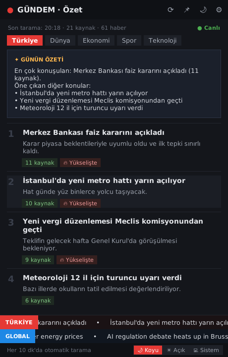

# Gündem Özet

Türkiye ve dünya gündemini gazetelerden, haber sitelerinden ve bloglardan tarayıp ücretsiz özetleyen küçük bir Windows masaüstü programı. Altta Türkiye ve Global için iki kayan haber bandı var. Koyu, açık ve sistem teması destekleniyor.



```
1) Python'u kurun (bir kerelik): https://www.python.org/downloads/
   Kurulumun ilk ekranında "Add python.exe to PATH" kutusunu işaretleyin.

2) Programı açmak için "gundem_ozet.pyw" dosyasına çift tıklayın.
   Başka hiçbir şey kurmanız gerekmez.

3) İsterseniz tek dosyalık bir .exe yapın: "EXE_Yap.bat" dosyasına çift tıklayın.
   Masaüstünüze GundemOzet.exe gelir. Bu .exe'yi Python kurulu olmayan
   bilgisayarlarda da açabilirsiniz.

Nasıl kullanılır
- ⟳ Hemen yeniden tarar. Normalde ayarladığınız aralıkla (varsayılan 10 dk) kendisi tarar.
- 📌 Pencere hep üstte kalır.
- 🌙 / ☀ Koyu ve açık tema arasında hızlı geçiş yapar. En alttaki "Koyu / Açık / Sistem"
  seçimiyle de tema seçebilirsiniz. "Sistem" seçilirse Windows temasına uyar.
- ⚙ Ayarlar: tema, tarama aralığı, hep üstte, kaynakları düzenleme.
- Bir habere ya da alttaki kayan banttaki bir başlığa tıklarsanız haber tarayıcıda açılır.
  Fareyi bandın üzerine getirince bant durur.

Kaynak eklemek (gazete, site, blog)
- ⚙ > "Kaynakları düzenle" kaynaklar.json dosyasını açar. Bir RSS adresini
  şu biçimde ekleyin:
  {"ad": "Blog adı", "url": "https://.../feed", "kategori": "turkiye", "tur": "blog"}
  kategori şunlardan biri olmalı: turkiye, dunya, ekonomi, spor, teknoloji, global
- Dosyayı kaydedip ⟳ tuşuna basın. Açılmayan bir kaynak sessizce atlanır.

Özetler nasıl çıkarılıyor?
Yapay zekâ ya da ücretli bir servis kullanılmaz. Program aynı olayı anlatan haberleri
farklı kaynaklardan bir araya toplar. Kaç kaynağın yazdığına ve haberin ne kadar yeni
olduğuna bakarak sıralar. Haber metinlerinden en çok ortak bilgiyi taşıyan cümleyi
özet olarak seçer.

Ayarlar ve kaynak listesi şu klasörde durur: %APPDATA%\GundemOzet
```

## Not

Bu proje kişisel ve ticari olmayan bir geliştirici projesidir. Program haberleri sitelerin herkese açık RSS akışlarından okur. Her haber için yalnızca başlığı, kısa bir özeti ve kaynağa giden bağlantıyı gösterir. Haberlerin tüm hakları ilgili yayın kuruluşlarına aittir.
